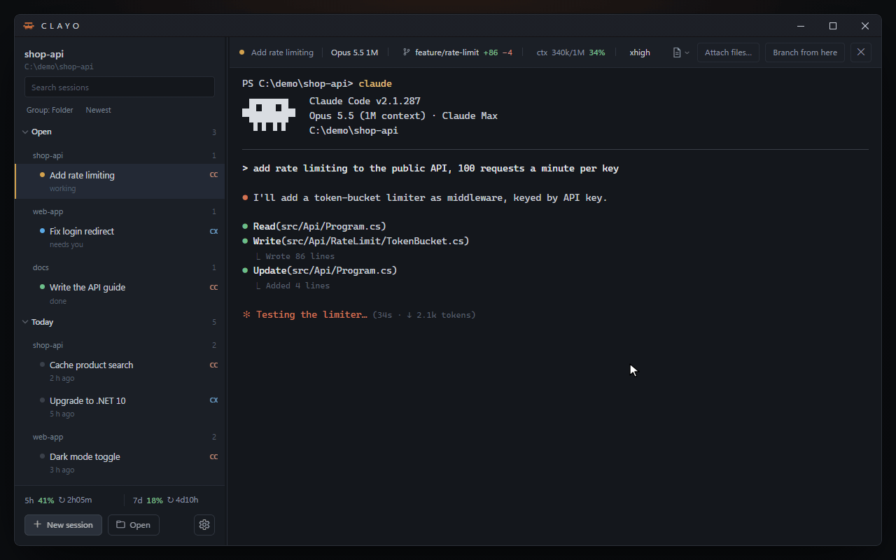
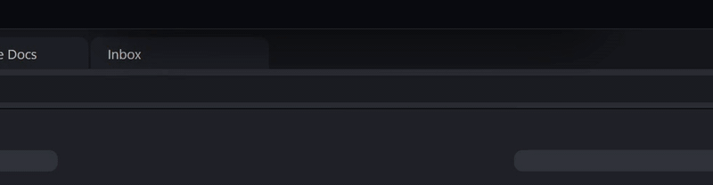
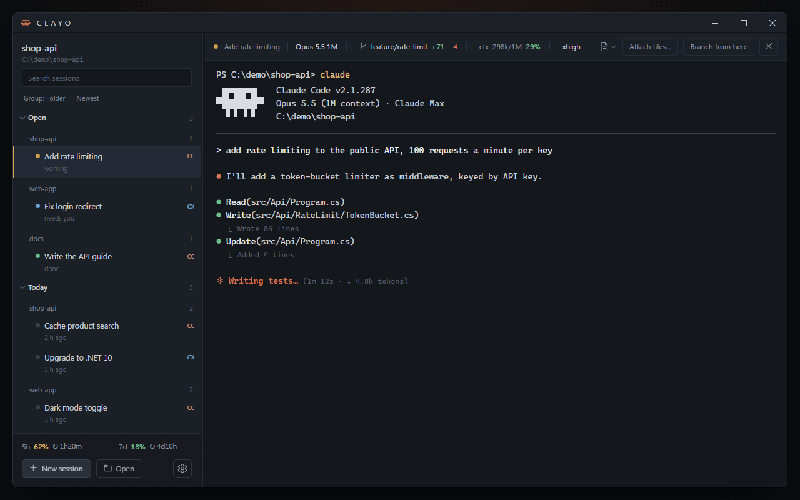
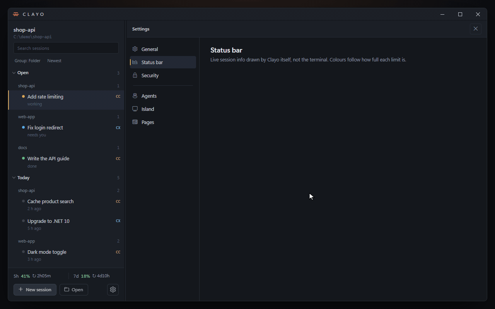
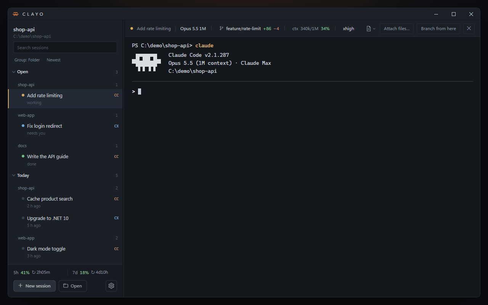
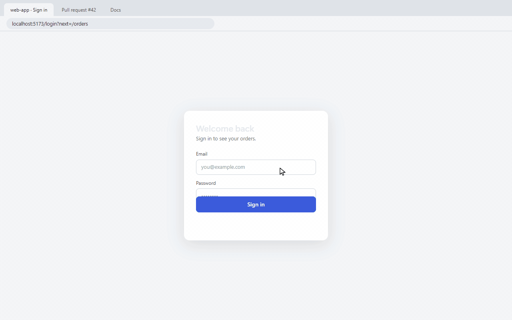

<div align="center">


# Clayo

### Run five coding agents at once. Know which one needs you.

Every Claude Code and Codex session in one Windows window, an island that taps you on the
shoulder, your usage always in sight, and pages your agents make that you can share.


**[Install in one line](#install)** · [Features](https://github.com/YogiOnCode/Clayo/wiki/Features) · [Wiki](https://github.com/YogiOnCode/Clayo/wiki)

</div>



You have four agent sessions in four terminals. One is waiting on a permission, one finished
ten minutes ago, one is about to hit your 5-hour limit, and you're in the browser. Clayo fixes
that, and it's free and open source.

## All your agents, one window

The **real** `claude` and `codex` you already use, each in a real terminal: slash commands,
plan mode, permission prompts, your own status line. Sessions sit on the left grouped by
folder, Claude Code and Codex side by side. Search, rename, resume with a click.
**Branch from here** forks a conversation into a new session, nested under its parent.
Close the window and they keep running.

## The island tells you who needs you

A small pill drops from the top of your screen when a session needs you or has finished,
whatever app you're in. It never steals focus. Click it and you're on that session. Glows blue
while a permission prompt waits for your answer.



## Your token usage, always in sight

No more `/usage` to find out you're at 95%. Every pane shows its model, context used, effort,
and git branch with diff. The sidebar keeps your **5-hour and 7-day limits** with the time to
reset, as Numbers, Bars, Rings or Chips, green to red. Near a limit, the island warns you once.



## Your permissions, your way

Agents work with your git and GitHub login. **Settings › Security › Ask before publishing**
makes every session Clayo starts stop and ask before it pushes, tags, releases, merges or
changes the repo on GitHub. Tick exactly what you want asked, per action, for Claude Code and
Codex. Your own allow / ask / deny rules sit beside them, so you see everything that applies.
Nothing is blocked, just one key to say yes.



## Pages your agents make, and you share

Type `/page` and a session turns the conversation into a **report, dashboard, diagram or
slide deck**, right beside the terminal. Change it with `/page make the title shorter`.
Present it full screen, export PDF or PNG, save it as one file that opens offline, or
**share a public link**. Clayo checks the page for keys, tokens and local paths before it
leaves your machine, and you can update or remove the link any time. Sharing signs in once
to the **Clayo Pages** GitHub App, which can reach your gists and nothing else. Every page from every
session lives in one **Pages** view.



## Screenshot straight into a session

Win+Shift+S, then **Ctrl+Alt+S**: the island asks which session it's for, and the image lands
in that prompt, ready for your question.



## And the small things

- **See what a session writes.** A `.md` it writes opens rendered beside the terminal and
  follows its edits. Pasted images show as thumbnails in the pane header.
- **Type `clayo` in any Explorer address bar** to open a session in that folder.
- **Drop a file or folder on the island** to open it in Clayo.
- **Set up in one screen.** Finds your agents, installs or signs in to the one you're missing.
- **Stays out of the way.** Starts at login, hidden until the island has something to say.
- **Updates itself** with one click, and waits until no session is working.
- **Light.** Panes you can't see draw nothing.

## Install

Open PowerShell, paste this and press Enter:

```powershell
irm https://raw.githubusercontent.com/YogiOnCode/Clayo/main/scripts/install.ps1 | iex
```

It runs [scripts/install.ps1](scripts/install.ps1): it downloads the latest release, checks it
against the release's SHA-256, puts it in `%LOCALAPPDATA%\Programs\Clayo` and starts it. Every
release zip is built on GitHub Actions; to check one yourself, run
`gh attestation verify clayo-<version>-win-x64.zip --repo YogiOnCode/Clayo`.

You need Windows 10 or 11, 64-bit, and [Claude Code](https://docs.claude.com/en/docs/claude-code)
or [Codex](https://github.com/openai/codex), or both. The first run finds them and installs or
signs in to the one you're missing. .NET comes inside the zip, and the
[WebView2 runtime](https://developer.microsoft.com/microsoft-edge/webview2/) is already on
Windows 11 and most Windows 10 PCs.

<details>
<summary>Install by hand</summary>

1. Download `clayo-<version>-win-x64.zip` from the
   [latest release](https://github.com/YogiOnCode/Clayo/releases/latest).
2. Unzip it into `%LOCALAPPDATA%\Programs` (paste that into Explorer's address bar), so you
   have `%LOCALAPPDATA%\Programs\Clayo\clayo.exe`. Keep it there: start at login and `clayo`
   in Explorer point at this folder.
3. Run `clayo.exe`. Clayo isn't signed yet, so Windows may say "Windows protected your PC":
   click **More info**, then **Run anyway**.

</details>

<details>
<summary>First run, updating, uninstalling</summary>

**First run.** The setup window looks for Claude Code and Codex; you need at least one.
**Install** runs its own installer in a PowerShell window you can watch (Codex needs
[Node.js](https://nodejs.org) first), **Sign in** does the same for signing in, and
**Locate…** points Clayo at an unusual install folder. Choose which agents to use and which one
**New session** starts, keep **Start Clayo when I sign in** and **Add clayo to my PATH**
ticked, and press **Open Clayo**. **Settings › Agents** brings this window back.

**Updating.** When a new release is out, an **Update to …** button shows above **New
session**. Press it: Clayo closes, updates and opens again, once no session is working or
asking you something. Idle sessions close; resume them from the sidebar. Clayo asks GitHub for
the latest release when it starts and every 12 hours after. Your settings are kept.

**Uninstalling.** In **Settings › Agents**, untick **Start Clayo when I sign in** and **Add
clayo to my PATH** and press **Open Clayo**. **Quit Clayo** from the gear menu, then delete
`%LOCALAPPDATA%\Programs\Clayo` (and `%LOCALAPPDATA%\Clayo` for your settings). Your Claude
Code and Codex sessions aren't touched.

</details>

<details>
<summary>Build from source</summary>

You need the [.NET 10 SDK](https://dotnet.microsoft.com/download/dotnet/10.0).

```powershell
git clone https://github.com/YogiOnCode/Clayo.git
cd Clayo
dotnet publish src/Clayo -c Release -r win-x64 --self-contained false -o $env:LOCALAPPDATA\Programs\Clayo
```

Then run `clayo.exe` from there; the setup window takes care of `PATH`. Keep the `Assets\`
folder next to `clayo.exe`, the terminal pane loads from it. `.\scripts\publish.ps1` builds
the release zip instead. The self-checks in `checks/` are file-based apps and run with the
same SDK.

</details>

## Use

- **New session**: the button at the bottom of the sidebar, or `clayo` in a folder.
- **Branch**: open a session, then **Branch from here** in its header.
- **A page**: `/page <what you want>` in a pane, or the **Page** button.
- **Settings**: the gear menu, or `Ctrl+,`.
- **Quit**: **Quit Clayo** in the gear menu or the island's menu. The close button only hides
  the window.

## Docs

| | |
|---|---|
| [Features](https://github.com/YogiOnCode/Clayo/wiki/Features) | Every feature with a short demo |
| [Claude Code and Codex](docs/AGENTS.md) | What works with each, Pages, installing them by hand |
| [Install](https://github.com/YogiOnCode/Clayo/wiki/Install) | Download, first run, updating, uninstalling |
| [Sessions and Branching](https://github.com/YogiOnCode/Clayo/wiki/Sessions-and-Branching) | What each button runs |
| [The Island](https://github.com/YogiOnCode/Clayo/wiki/The-Island) | Notices, peek, drop to open, screenshots |
| [Status Bar and Limits](https://github.com/YogiOnCode/Clayo/wiki/Status-Bar-and-Limits) | Pane header, usage limits, themes |
| [Pages](https://github.com/YogiOnCode/Clayo/wiki/Pages) | `/page`, the Pages view, export and sharing |
| [Settings](https://github.com/YogiOnCode/Clayo/wiki/Settings) | Every option, Security included |
| [Troubleshooting](https://github.com/YogiOnCode/Clayo/wiki/Troubleshooting) | When something looks wrong |
| [How It Works](https://github.com/YogiOnCode/Clayo/wiki/How-It-Works) | The code, module by module |
| [Roadmap](https://github.com/YogiOnCode/Clayo/wiki/Roadmap) | What's next |

## Contributing

Issues and pull requests are welcome. Open an issue before a big change so we can agree on
the approach first. Pull requests to `main` need one review and are squash-merged. See
[Contributing](https://github.com/YogiOnCode/Clayo/wiki/Contributing) for building and
running the checks. Found a security issue? Report it privately from the **Security** tab,
not in an issue.

## Privacy

Not affiliated with Anthropic or OpenAI. Clayo reads `~/.claude` and `~/.codex` and never
writes to either. Its only network call of its own is asking GitHub for the latest release, at
start and every 12 hours; a page goes online only when you create a public link for it. Where
Clayo keeps files is listed in
[How It Works](https://github.com/YogiOnCode/Clayo/wiki/How-It-Works#where-clayo-keeps-its-files).

MIT licensed, see [LICENSE](LICENSE). Bundles [xterm.js](https://github.com/xtermjs/xterm.js)
and its fit and WebGL addons (MIT, see `src/Clayo/Assets/xterm/LICENSE.xterm`), and
[marked](https://github.com/markedjs/marked) (MIT, see `src/Clayo/Assets/markdown/LICENSE.marked.md`).
